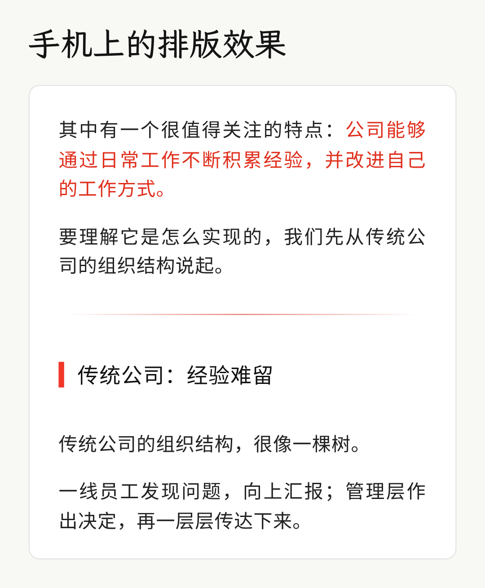
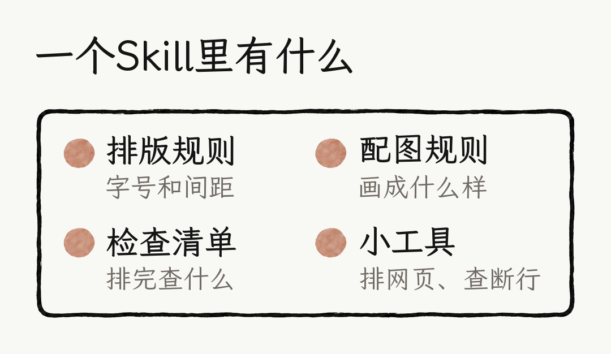
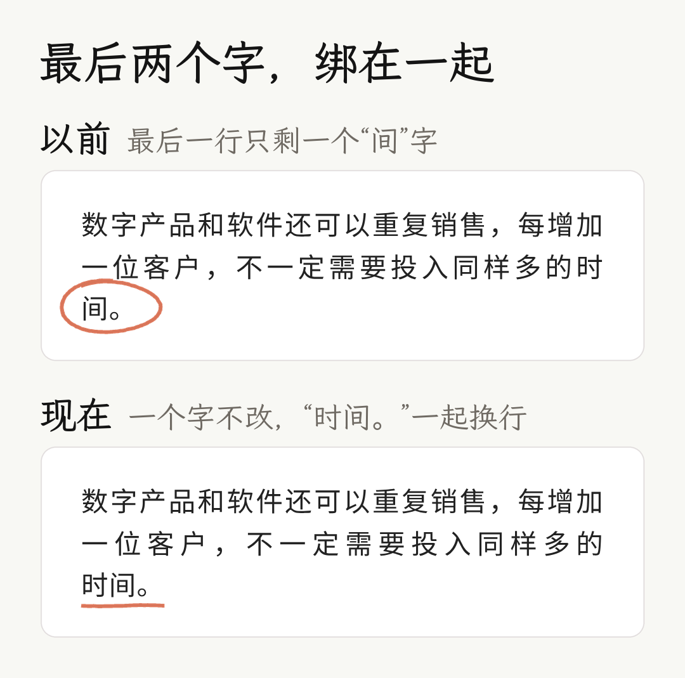
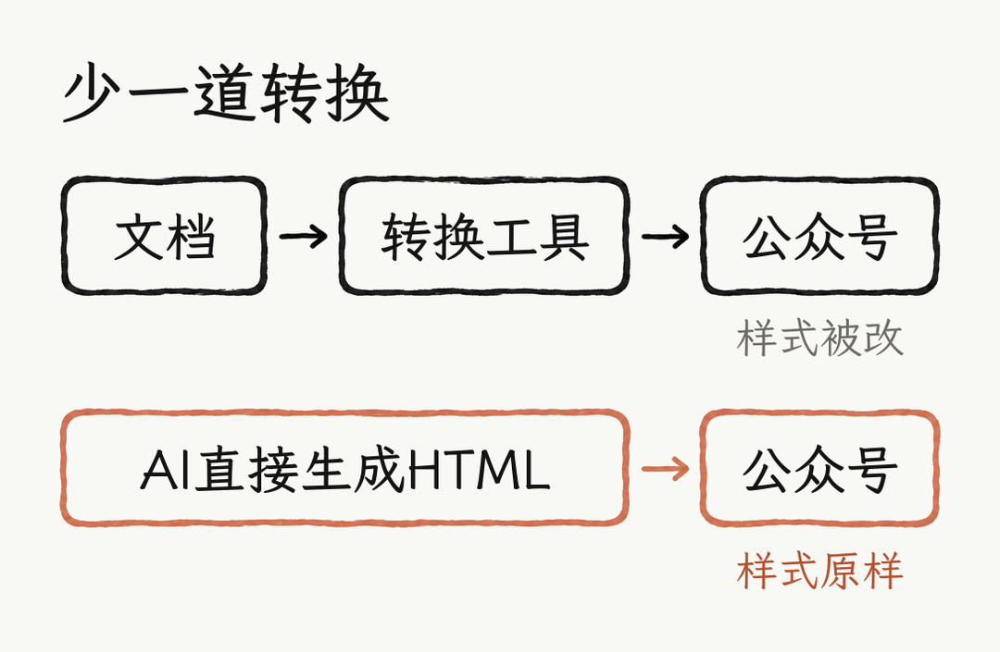
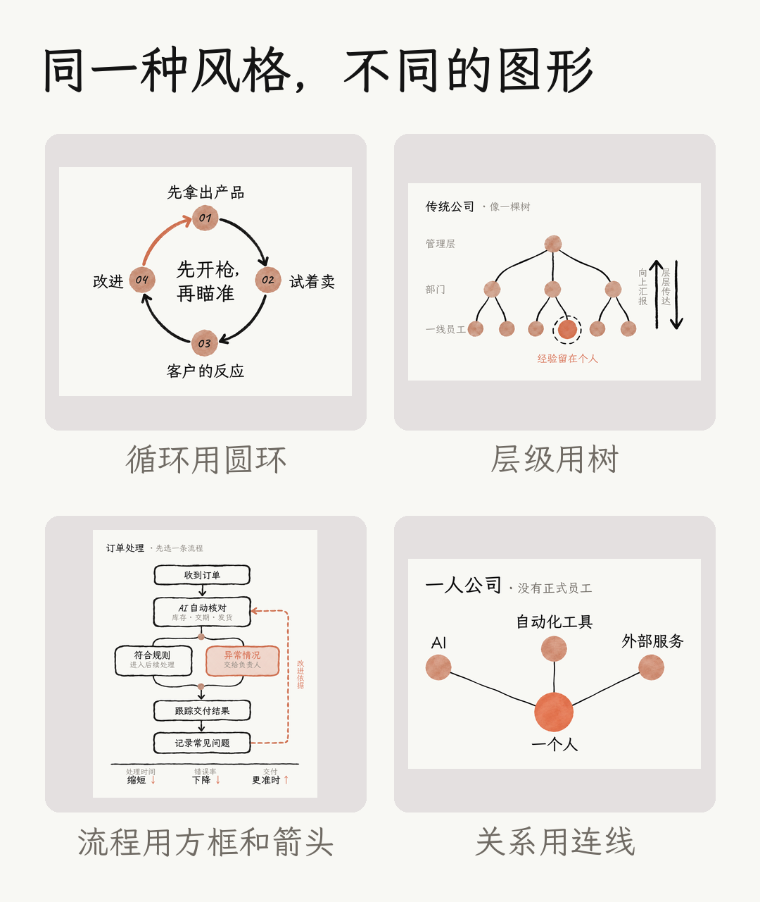
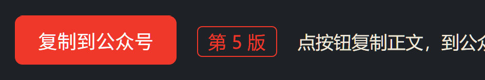
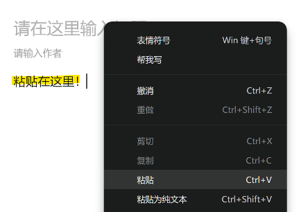

# A社风格公众号排版 Skill

文章自己写，排版交给 AI。把写好的文章交给 Claude，拿到一份能直接粘贴进微信公众号的 HTML，配图和封面也一起处理。

**非商业用途（包括个人的非商业使用）免费；商业用途需要授权。** 详见文末的[许可与授权](#许可与授权)。



## 为什么做这个

公众号排版有几个很常见的问题：字体随手选，字号、行距没细调；颜色太多，满屏都是重点，反而找不到重点；装饰太花，内容被挤到后面；直接套用排版网站的模板，篇篇长得差不多。

对长文来说，排版不是装饰，而是阅读体验的一部分。读者点开文章，最先看到的是这一屏的样子：字看着舒不舒服，段落透不透气，重点能不能一眼找到。

这套排版的原则是：**尽量克制，让读者把注意力放在内容上。**

## 它是什么

Skill 可以理解成写给 AI 的一份说明书，加上几个小工具。说明书写清楚公众号怎么排版、每个字号和每处间距定多少、配图画成什么风格、排完要检查什么；小工具负责把文章排成网页、检查断行。



- **只排版，不写文章**：原文一个字都不动，只添加小标题、重点样式、引用框和配图位置。
- **每次都按同一套标准**：排版又细又碎，人工很难每次都调得一致。规则写进 Skill，AI 每次照着排。
- **交付前独立检查**：另开一个没参与制作的 AI，按清单逐项核对正文、断行、字号、留白和图片，不通过就改，最多三轮。

## 版式细节

- 正文 17px，行高 1.56，文字用深灰色 #222222，不用纯黑。
- 整篇只用黑、灰、红三种颜色；重点用红字标出，不加粗，也不加荧光笔底色。
- 大标题左边一根红色竖线，标题之间用渐隐的细线隔开，引用放进浅灰色底框，配红色水滴引号。
- 标题上下、分隔线上下的空白都按固定比例调过。
- **任何手机都不出单字落行**：每段最后两个字连同标点绑在一起，不管读者的手机多宽、字体是什么，最后一行都至少有两个字，也不会出现只有标点的行，不需要为断行改原文。有浏览器时，还会把 340 到 450px 的每一种手机宽度实际渲染一遍来验证。
- **人名不拆行**：「李飞飞」「Genie 4」这类人名和产品名整个排在同一行，不会拆成两半。常用词和概念词不锁，免得行与行之间字距不一。
- **字距统一**：两端对齐时，一行少排了一个字，这一行就会被拉松。排完会在 402 宽的小屏和 440 宽的大屏上逐行检查，有拉松的行就微调说法让它排满，每处改动都列出来。



## 为什么直接生成 HTML

- **用 Word 排**：贴进公众号后台，颜色、边框和间距容易走样。
- **先写 Markdown，再用工具转换**：每多一道转换，就多一次丢失样式的可能，本地图片也可能带不过去。
- **用排版网站**：样式大多是预设好的，只能在现有模板里挑，想按自己的审美调细节不太方便。

这个 Skill 让 AI 直接生成 HTML，把样式写在每一段、每个标题上（内联样式），这是公众号编辑器能保留下来的写法。装好就能用，不用注册排版网站，也不用另外买排版工具。



## 配图和封面

**配图**：象牙白底、陶土色水彩圆点、手绘墨线、大量留白。具体画什么由文章内容决定：讲循环就画圆环，讲层级就画树，讲流程就画方框和箭头。图里的字按手机阅读来定字号；为了不出错字，先生成不带字的底图，再用代码叠加手写字体，文字的位置和大小可以单独调，不用反复重新生图。圆环、流程、容器三种常见图，脚本会按真实字体自动算好坐标和间距。



生图有三种方式：

1. **Claude 连了生图工具（MCP）**：直接调用生图工具，配图和排版一次完成。
2. **没连 MCP，用 Claude Code**：Skill 生成一份给 ChatGPT Work 的生图指令，放进项目文件夹。两个工具在同一个项目文件夹里工作，ChatGPT Work 负责生图，Claude 负责排版和插图，不需要另外接入生图 API。
3. **直接在 ChatGPT Work（或 Codex）里用**：生图和排版在同一个项目里完成，不用在两个工具之间来回传文件。

在 Claude 网页版或手机上、又没有生图工具时，会给你一份生图指令，图画好后发回来，它会放进文章，出下一版。

**封面**：每篇出四张不同风格的封面给你挑，附一张对比图（信息流缩略图和 1:1 裁切并排）。两张参考封面只用来学「为什么好看」，构图每次重新设计；要画人时用无五官的白色石膏像（白模），不用真人的脸。封面和内文配图分开生成，用同一套风格参考。

## 适合什么内容

以文字为主、需要读者静下心来读的干货长文：知识分享、科普、读书笔记、行业观察、课程讲义。

## 安装

- **Claude（网页版、桌面版）**：
  1. 先确认已打开代码执行：设置 > Capabilities 里的「Code execution and file creation」（新版设置里叫「Create and edit files」）。Skill 要靠它运行。
  2. 在本仓库点开 `wechat-official-account-formatting.zip`，用「Download raw file」下载。不要用 Code > Download ZIP 下载整个仓库，那样 SKILL.md 会多套一层文件夹，上传不了。
  3. 在 Claude 里打开 Customize > Skills，点「+」，选「Create skill」>「Upload a skill」，上传这个压缩包。
- **Claude Code**：把 `wechat-official-account-formatting` 文件夹复制到 `~/.claude/skills/`（所有项目可用）或项目里的 `.claude/skills/`。
- **其他支持 SKILL.md 的工具**：按各自的说明放置这个文件夹。

## 使用

1. **发文章**：把写好的文章发给 Claude，说一句：「用公众号排版 Skill 排一下这篇文章。」配图按上面的三种方式之一生成，最后得到一份带版本号的 HTML（第 N 版），附一张检查结果表。
2. **复制**：用浏览器打开 HTML，先确认顶部的版本号是最新的，再点「复制到公众号」。

   

3. **粘贴**：打开公众号后台，新建一篇图文，在正文开头点右键选「粘贴」（不要选「粘贴为纯文本」），或者直接按 Ctrl+V。

   

4. **发布**：标题不在复制范围内，单独填进标题栏；再填好摘要、载入封面，按平时的流程发布。配图通常会一起复制过去，哪张没成功，在原来的位置重新插入就行。

## 运行环境

排版和基本检查只需要 Python 3，不用装任何包。浏览器实测断行和配图排版还需要：

- Python 3、Pillow、NumPy、Playwright：`pip install pillow numpy playwright`，再运行 `playwright install chromium`。也可以用环境变量 `CHROME_PATH` 指定本机的 Chrome。
- 浏览器实测断行用 Noto Sans CJK SC、Noto Serif CJK SC，以及 Carlito、Liberation Sans、Liberation Serif、DejaVu Sans，模拟不同手机上的字宽，缺了会打印警告。Debian / Ubuntu 可以用 `apt install fonts-noto-cjk fonts-noto-cjk-extra fonts-crosextra-carlito fonts-liberation fonts-dejavu-core` 安装，也可以从 Google Fonts 等处下载。
- 配图文字用霞鹜文楷 LXGW WenKai（[github.com/lxgw/LxgwWenKai](https://github.com/lxgw/LxgwWenKai)）和 Caveat，都是 SIL OFL 开源字体，需要自己下载。用环境变量 `WENKAI_DIR`、`CAVEAT_FILE` 指定位置。

## 文件结构

```
wechat-official-account-formatting/
├── SKILL.md                 流程、版式参数、断行规则
├── LICENSE                  许可协议（CC BY-NC 4.0）
├── references/
│   ├── images.md            内文配图的规则和流程
│   ├── cover.md             封面的设计原则、四张怎么拉开和流程
│   └── checklist.md         交付前的独立检查表
├── assets/
│   ├── approved/            4 张定稿配图，生图时当作风格参考（原创）
│   ├── covers/              两张封面参考图（墨线插画、白模）
│   ├── sample_marked.txt    标记稿示例
│   └── quote-mark.png       引用块的引号小图
└── scripts/
    ├── build_html.py        把标记稿排成可粘贴的 HTML（自带尾字锁定，只用标准库）
    ├── selfcheck.py         不用浏览器的结构检查（只用标准库）
    ├── htmlcheck.py         浏览器实测断行：340 到 450px 每一种宽度
    ├── phonecheck.py        小屏和大屏实测：人名有没有拆开、字距是否统一
    ├── diagram.py           配图半自动排版：圆环、流程、容器
    ├── coversheet.py        四张封面的对比图
    ├── gapmeasure.py        量标题和段落之间的空白
    └── wireframe.py         手工排其他配图用的画布工具
```

## 说明

- 「A社风格」指配图参考了 Anthropic 插画的配色和笔触，比如官网 [Introducing Claude](https://www.anthropic.com/news/introducing-claude) 一文的头图。这是个人作品，和 Anthropic 官方没有关系。Anthropic 的图片版权属于 Anthropic，仓库里不包含，需要参考时请到原页面查看。
- 公众号编辑器的行为可能会变。粘贴后如果有图片没跟过去，在原位置重新插入即可。

## 许可与授权

本项目采用[「知识共享 署名-非商业性使用 4.0 国际」许可协议（CC BY-NC 4.0）](https://creativecommons.org/licenses/by-nc/4.0/)，范围包括 SKILL.md、references 里的规则、脚本、定稿配图、封面参考图、示例图和本说明。法律文本见 [LICENSE](LICENSE)。

**可以免费做的（非商业用途）**

- 个人在自己的公众号、博客上，用它排版自己写的文章。
- 学习、研究和个人练习。
- 修改、转发和分享，但不能收费。

免费使用要遵守两点（署名只在分享、转发或发布修改版时需要）：

- **署名**：注明作品名「A社风格公众号排版 Skill」、作者 aidenlychen-debug、[本仓库链接](https://github.com/aidenlychen-debug/wechat-official-account-formatting)和许可协议（CC BY-NC 4.0，附链接）；改过的话，注明已修改。
- **非商业**：不用于商业目的，也不能给别人附加更严格的限制。

**需要先取得书面授权的（商业用途）**，包括但不限于：

- 用它给客户代排版、代运营，或作为任何收费服务的一部分。
- 企业、品牌等以营利为目的的账号用它排版发布内容。
- 放进付费课程、付费社群、收费训练营或收费培训资料。
- 打包转售，或集成进收费的软件、插件、模板和在线服务。
- 把本项目（或修改版）的规则、脚本、定稿配图对外出售。

拿不准算不算商业用途（比如个人账号接了广告或推广），请先联系确认。

**商业授权联系方式**：在本仓库[提 Issue](https://github.com/aidenlychen-debug/wechat-official-account-formatting/issues)，写明用途和使用范围。

**其他说明**

- 这里是许可条款的中文说明，和 LICENSE 里的 CC BY-NC 4.0 法律文本不一致时，以法律文本为准。本说明不构成法律意见。
- CC BY-NC 不属于开源许可（OSI 的定义要求允许商用），所以本项目是「免费公开、非商业可用」，不是开源软件。
- 霞鹜文楷和 Caveat 字体不在仓库里，按各自的 SIL OFL 许可使用。Anthropic 的图片也不在仓库里。

## 反馈

用的过程中遇到问题，或者有更好的改法，欢迎提 Issue。
