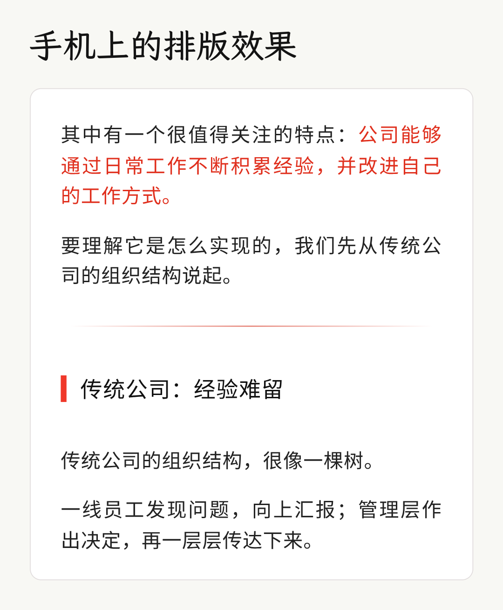
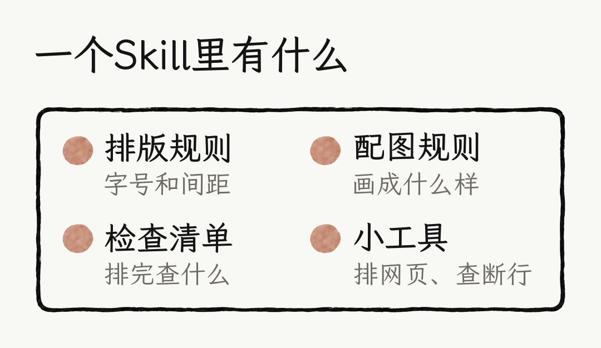
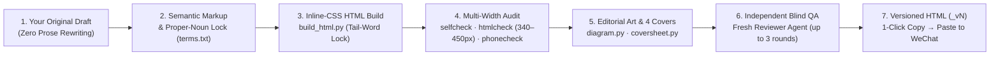
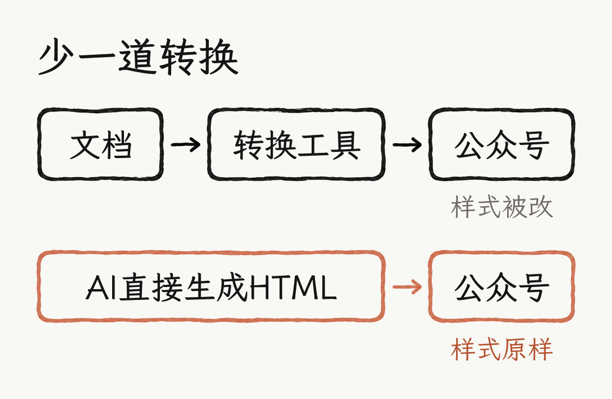
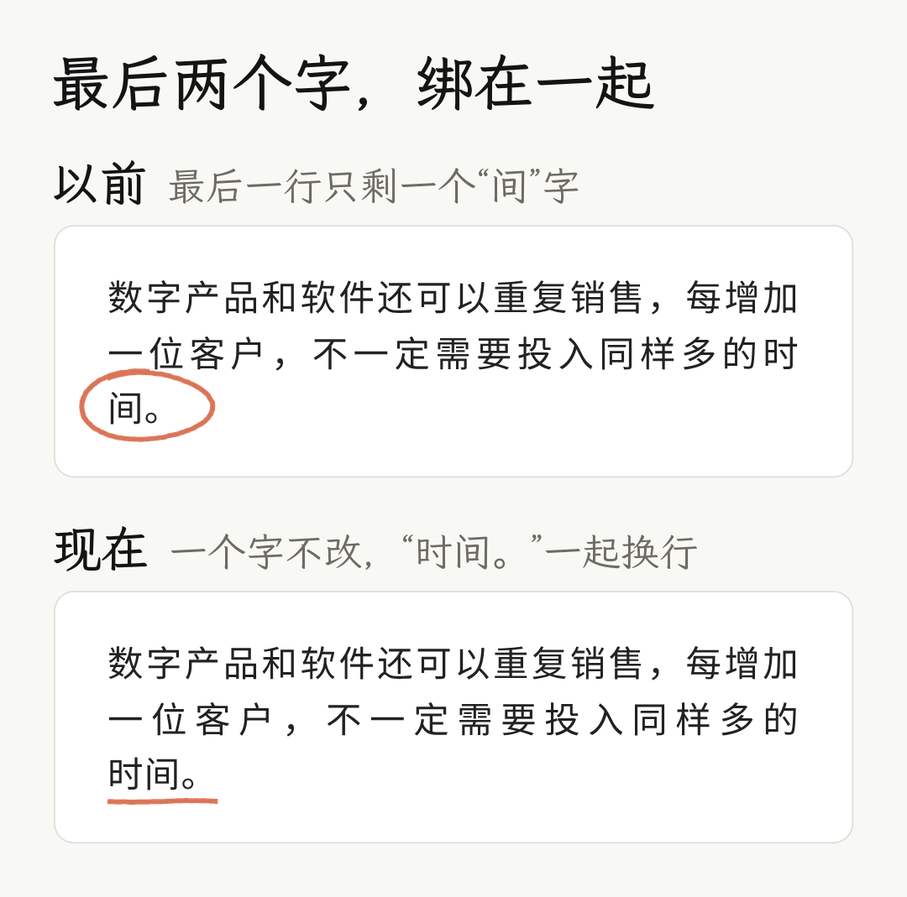
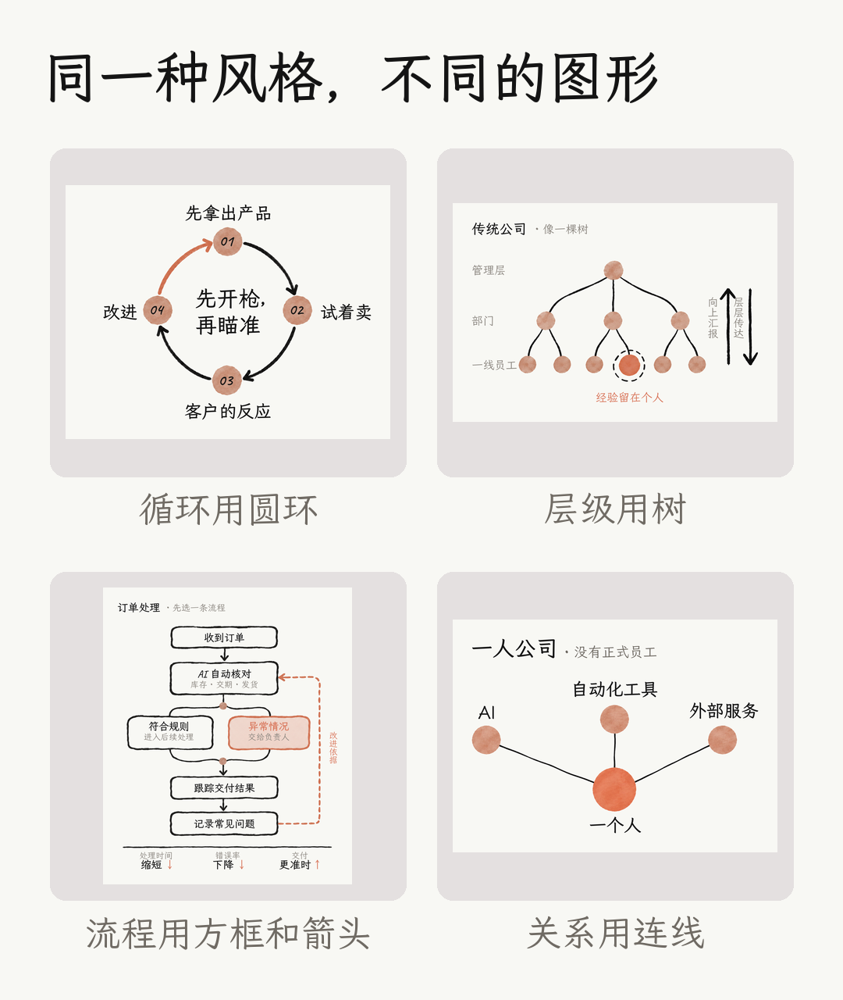
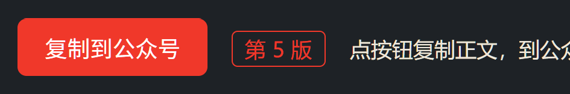
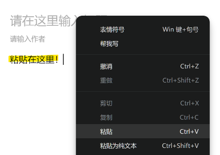

# WeChat Official Account Formatting Skill

**Anthropic-Inspired Editorial Typesetting, Visual Production & Zero-Orphan Verification for WeChat Long-Form Articles**

[](#installation)
[](#environment--dependencies)
[](#deterministic-mobile-typography--zero-orphan-guarantee)
[](#license--commercial-authorization)

> **You write the article; AI handles publication-grade WeChat formatting.** Hand your finished draft to Claude (or any SKILL.md-compatible agent) and receive paste-ready inline HTML, cohesive editorial illustrations, four distinct cover options, and an independent quality audit — guaranteed to produce **zero orphan single-character lines on any smartphone screen**.

**Free for personal & non-commercial use; commercial use requires written authorization (CC BY-NC 4.0).** See [License & Commercial Authorization](#license--commercial-authorization).



---

## Why This Skill Exists

Most Chinese long-form WeChat articles suffer from the same preventable layout failures:

- **Visual noise over readability**: Random fonts, untuned line heights, rainbow highlights, and decorative templates that compete with the writing.
- **Broken conversions**: Pasting from Word warps margins and colors; converting via Markdown tools strips borders, shifts accent hues, or drops local images; template websites trap you inside generic presets.
- **Mobile orphan lines & uneven spacing**: Editing wording by hand to fix a single dangling character on your phone immediately breaks again on another reader's screen width or Android serif font.

This Skill encodes one strict editorial philosophy: **restraint first — remove visual friction so readers stay immersed in your ideas.**

---

## How It Works

An Agent Skill pairs a **precision editorial specification** (`SKILL.md` + `references/`) with **deterministic verification scripts** (`scripts/`):





- **Formats without rewriting**: Your original prose stays intact word-for-word; the agent only adds headings, semantic highlights, callout blocks, and illustration placements.
- **Consistent every single time**: Exact pixel margins, typographic ratios, color tokens, and art direction are codified once and applied identically to every article.
- **Independent pre-delivery audit**: A separate reviewer agent (blind to the production run) inspects the final HTML against `references/checklist.md` — checking text fidelity, line breaks, spacing ratios, and images for up to 3 repair rounds before delivery.

---

## Direct Inline HTML — Zero Conversion Loss

| Approach | What Breaks |
|---|---|
| **Word → WeChat Editor** | Colors, borders, and paragraph spacing shift unpredictably on paste |
| **Markdown → Third-Party Converter** | Extra conversion step drops custom CSS borders, indentation, and local images |
| **SaaS Template Sites** | Rigid presets, generic look, subscription lock-in |
| **This Skill (Direct Inline HTML)** | Every style is written inline on the element — exactly what WeChat's editor preserves, with base64-embedded artwork and a 1-click **Copy to WeChat** button |



---

## Deterministic Mobile Typography & Zero-Orphan Guarantee

Every visual parameter is tuned specifically for deep long-form mobile reading:

- **Restrained 3-Color System**: `#222222` deep charcoal body text (`17px`, `1.56` line height — never harsh pure black), neutral grays for structure and callouts, and `#E0301E` / `#F0382A` terracotta-red accents for key phrases (no bold clutter, no highlighter backgrounds).
- **Calibrated Structural Hierarchy**: `5px` red left-bar section headers, subtle gradient dividers between sections, light-gray quote blocks (`#F2F2F2`) with custom high-DPI red teardrop quotation marks (rendered as embedded PNG so Windows/Android never fall back to missing Optima glyphs), and mathematically proportioned vertical breathing ratios verified by `scripts/gapmeasure.py`.
- **Zero Single-Character Orphan Lines on Any Phone**: `scripts/build_html.py` automatically wraps the final two characters plus trailing punctuation of every paragraph, heading, quote line, and reference item inside `white-space:nowrap` (**Tail-Word Lock**). No matter how wide the reader's screen or which system font renders, the last line always holds at least two characters — with zero text rewriting required.
- **Proper-Noun Protection & Uniform Kerning**: Names and products (e.g., `Genie 4`, `World Labs`, plus custom names in `terms.txt`) stay intact on one line. Paragraphs containing long English tokens automatically switch to left-alignment to prevent justified spacing gaps. `scripts/htmlcheck.py` renders the HTML across **every width from 340px to 450px across 4 font stacks**, and `scripts/phonecheck.py` verifies uniform justification on both `402px` and `440px` screens.



---

## Cohesive Editorial Illustrations & 4-Variant Covers

### In-Article Diagrams & Illustrations
- **Signature Visual Style**: Warm ivory background, terracotta watercolor dots, hand-drawn ink lines, and generous whitespace. Visual structure follows content semantics — rings for cycles, trees for hierarchies, boxes and arrows for workflows.
- **Zero AI Gibberish Text**: Generates clean text-free base artwork first, then overlays crisp handwritten typography (`LXGW WenKai` + `Caveat`) programmatically so text positions and sizes can be tuned independently without regenerating images. For rings, flows, and container layouts, `scripts/diagram.py` computes exact coordinates from real font metrics.



- **Three Flexible Image-Generation Paths**:
  1. **Claude + Image MCP**: Generates illustrations and completes HTML formatting in one seamless pass.
  2. **Claude Code + ChatGPT Work (Shared Folder)**: Skill writes structured image briefs into the project folder for ChatGPT Work to render while Claude handles HTML assembly — no separate image API key required.
  3. **ChatGPT Work / Codex Direct**: Handles image generation and formatting inside a single workspace.
  *(On Claude web/mobile without an image tool, the Skill outputs copy-ready prompts and inserts your returned images into the next versioned HTML.)*

### Four Distinct Cover Proposals
- Produces **4 visually differentiated cover concepts** per article alongside a side-by-side comparison sheet (`scripts/coversheet.py`) showing both the **WeChat feed thumbnail** and **1:1 square crop**.
- Uses two original reference covers (`assets/covers/`) strictly for aesthetic principles — re-composing fresh layouts every time, and rendering human figures as minimalist faceless white plaster busts rather than photorealistic faces.

---

## Ideal Use Cases

Built for **text-first, high-signal long-form writing** where readers slow down to think: deep essays, technical explainers, book notes, industry analyses, and course handouts.

---

## Installation

### Claude Web / Desktop
1. Enable **Code execution and file creation** (or **Create and edit files**) under **Settings → Capabilities**.
2. Open [`wechat-official-account-formatting.zip`](./wechat-official-account-formatting.zip) in this repository and click **Download raw file** *(do not use `Code → Download ZIP` on the whole repository, which adds an extra nesting folder)*.
3. Go to **Customize → Skills → `+` → Create skill → Upload a skill**, and upload the `.zip` file.

### Claude Code / Cursor / Codex / Other `SKILL.md` Agents
Copy the `wechat-official-account-formatting/` directory into your global or project skills folder:

```bash
# Global (Claude Code example)
cp -r wechat-official-account-formatting ~/.claude/skills/

# Or project-local
cp -r wechat-official-account-formatting .claude/skills/
```

---

## Usage Workflow

1. **Send your draft**: Share your finished article with your agent and ask it to format with the **WeChat Official Account Formatting Skill**. You receive a versioned HTML file (`_vN.html`) plus an independent QA audit table.
2. **Copy with one click**: Open the HTML file in your browser, confirm the version badge at the top, and click **"复制到公众号" (Copy to WeChat)**.

   

3. **Paste directly into WeChat**: Open the WeChat Official Account editor, create a new post, right-click at the start of the body and choose **Paste** (`Ctrl+V` / `Cmd+V` — do *not* choose "Paste as plain text").

   

4. **Publish**: Enter the article title into WeChat's title field (intentionally excluded from the copy region), add your summary and selected cover image, and publish. Embedded images transfer automatically; if any image fails to upload, simply re-insert it at the marked slot.

---

## Environment & Dependencies

- **Core Formatting & Structural Audit (`build_html.py`, `selfcheck.py`)**: **Python 3 standard library only** — zero packages required.
- **Full Browser Line-Break Testing & Diagram Layout (`htmlcheck.py`, `phonecheck.py`, `gapmeasure.py`, `diagram.py`, `coversheet.py`, `wireframe.py`)**:
  ```bash
  pip install pillow numpy playwright
  playwright install chromium
  ```
  *(Optionally set `CHROME_PATH` to use an existing local Chrome binary.)*
- **Fonts for Cross-Device Verification & Diagram Overlays**:
  - Multi-phone rendering test: `Noto Sans CJK SC`, `Noto Serif CJK SC`, `Carlito`, `Liberation Sans`, `Liberation Serif`, `DejaVu Sans` (on Debian/Ubuntu: `apt install fonts-noto-cjk fonts-noto-cjk-extra fonts-crosextra-carlito fonts-liberation fonts-dejavu-core`).
  - Diagram typography (SIL OFL, downloaded separately): [LXGW WenKai](https://github.com/lxgw/LxgwWenKai) and `Caveat`, pointed to via `WENKAI_DIR` and `CAVEAT_FILE`.

---

## Repository Structure

```text
wechat-official-account-formatting/
├── SKILL.md                   # End-to-end workflow, CSS tokens, spacing ratios & line-break rules
├── LICENSE                    # CC BY-NC 4.0 legal text
├── references/
│   ├── images.md              # In-article illustration guidelines & generation workflows
│   ├── cover.md               # Cover art direction, 4-variant differentiation & pipeline
│   └── checklist.md           # Independent blind QA checklist & repair loop
├── assets/
│   ├── approved/              # 4 original reference diagrams (flow, tree, ring, org)
│   ├── covers/                # 2 original cover references (ink illustration, white bust)
│   ├── sample_marked.txt      # Complete annotated manuscript example
│   └── quote-mark.png         # High-DPI red teardrop quotation mark asset
└── scripts/
    ├── build_html.py          # Zero-dep markup → inline-CSS HTML compiler (with tail-word & noun lock)
    ├── selfcheck.py           # Zero-dep structural & text-fidelity checker
    ├── htmlcheck.py           # Playwright browser line-break verifier across 340–450px × 4 font stacks
    ├── phonecheck.py          # 402px & 440px visual spacing & proper-noun integrity verifier
    ├── diagram.py             # Semi-automated ring, flow, and container diagram layout engine
    ├── coversheet.py          # 4-cover feed thumbnail + 1:1 crop comparison sheet generator
    ├── gapmeasure.py          # Visual pixel-gap measurement tool for heading/paragraph rhythm
    └── wireframe.py           # Custom diagram canvas toolkit
```

---

## Notes & Disclaimers

- **Visual Inspiration**: The editorial illustration palette draws inspiration from Anthropic's publication art direction (e.g., [Introducing Claude](https://www.anthropic.com/news/introducing-claude)). This is an independent personal project with no affiliation with Anthropic, and no Anthropic artwork is included in this repository.
- **WeChat Editor Compatibility**: WeChat's rich-text editor behavior may evolve over time. If an embedded image occasionally does not transfer on paste, re-insert the image at the marked position.

---

## License & Commercial Authorization

This project (including `SKILL.md`, `references/`, `scripts/`, `assets/`, `examples/`, and this `README`) is licensed under the **[Creative Commons Attribution-NonCommercial 4.0 International License (CC BY-NC 4.0)](https://creativecommons.org/licenses/by-nc/4.0/)**. Full legal text is in [LICENSE](./LICENSE).

### Free for Personal & Non-Commercial Use
- Formatting your own non-commercial articles for personal WeChat accounts or blogs.
- Personal learning, research, and experimentation.
- Modifying and sharing for non-commercial purposes (attribution required when sharing or publishing derivatives: credit **WeChat Official Account Formatting Skill**, author **aidenlychen-debug**, link to [this repository](https://github.com/aidenlychen-debug/wechat-official-account-formatting), cite **CC BY-NC 4.0**, and note any modifications).

### Commercial Use Requires Prior Written Authorization
Prior written authorization from the author is required for any commercial use, including but not limited to:
- Ghostwriting, formatting services, or agency account operations for paying clients.
- Publishing content for for-profit companies, brands, or monetized commercial accounts.
- Inclusion in paid courses, paid communities, bootcamps, or commercial training materials.
- Bundling, reselling, or integrating these rules, scripts, or reference assets into paid software, plugins, templates, or SaaS products.

*(Uncertain whether your use qualifies as commercial — e.g., sponsored personal posts? Please inquire first.)*

**Commercial Licensing Inquiries**: Open an issue in [GitHub Issues](https://github.com/aidenlychen-debug/wechat-official-account-formatting/issues) describing your intended use case and scope.

*(Note: CC BY-NC 4.0 is a source-available non-commercial license rather than an OSI-approved open-source license. Third-party fonts LXGW WenKai and Caveat are not bundled and remain under their respective SIL OFL licenses.)*

---

## Feedback

Found a layout edge case or have an improvement idea? Please open an [Issue](https://github.com/aidenlychen-debug/wechat-official-account-formatting/issues).
